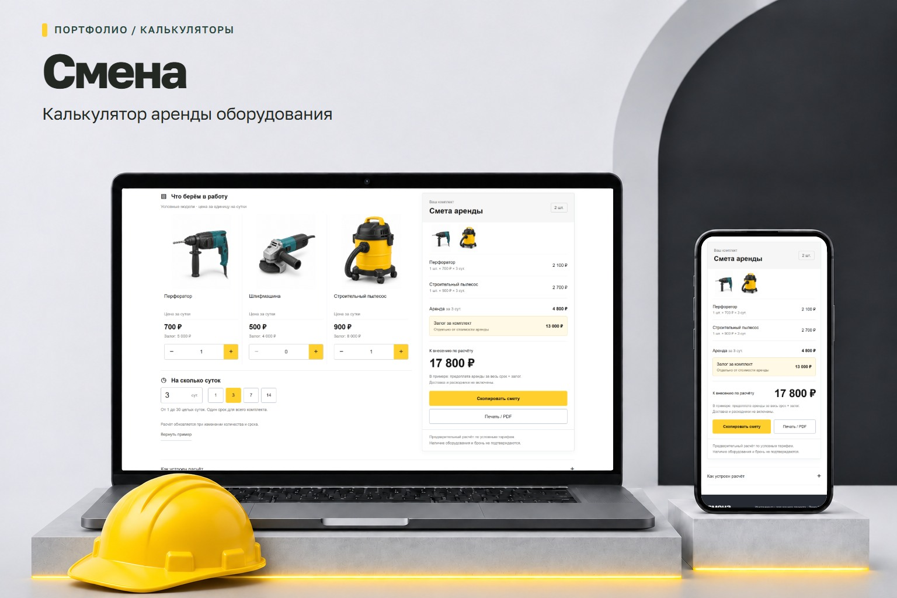
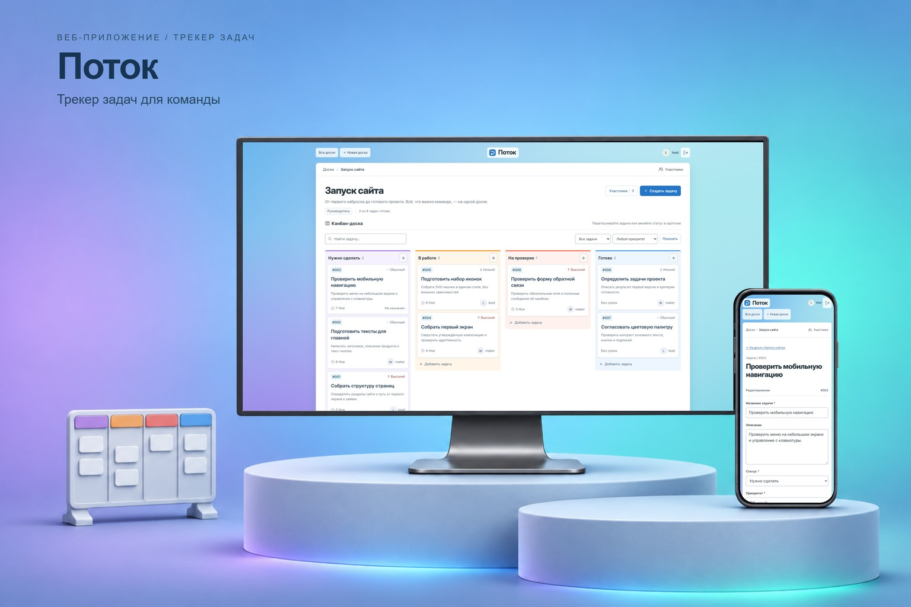

# Решаю задачи бизнеса с помощью сайтов и веб-приложений

<table role="presentation">
  <tr>
    <td valign="middle">&nbsp;<strong>10+ лет в веб-разработке</strong></td>
    <td valign="middle">&nbsp;<strong>Опыт работы в команде</strong></td>
    <td valign="middle">&nbsp;<strong>Свои проекты</strong></td>
  </tr>
</table>

## Чем могу помочь

<table role="presentation">
  <tr>
    <td width="92" valign="middle"></td>
    <td valign="middle"><strong>Представить услугу или продукт онлайн</strong> 
      Сделаю сайт, на котором клиент сможет разобраться в предложении, выбрать подходящий вариант и оставить заявку.</td>
  </tr>
  <tr>
    <td valign="middle"></td>
    <td valign="middle"><strong>Рассчитать стоимость по вашим правилам</strong> 
      Сделаю калькулятор, в котором клиент или сотрудник сможет выбрать нужные параметры, сразу увидеть итог и понять, из чего он складывается.</td>
  </tr>
  <tr>
    <td valign="middle"></td>
    <td valign="middle"><strong>Вести учёт и видеть, что меняется</strong> 
      Сделаю трекер, в котором можно фиксировать нужные данные, видеть текущее состояние и смотреть, как оно менялось со временем.</td>
  </tr>
  <tr>
    <td valign="middle"></td>
    <td valign="middle"><strong>Доработать то, чем вы уже пользуетесь</strong> 
      Разберусь в существующем сайте или приложении и добавлю нужную функцию, исправлю неудобный сценарий или обновлю страницу.</td>
  </tr>
</table>

## Примеры решений

  <a href="https://gate-service-demo-mw.pages.dev/"><picture><source media="(max-width: 767px)" srcset="assets/cases/gates-overview.jpg" width="1536"></picture><picture><source media="(max-width: 767px)" srcset="assets/cases/gallery-gap.svg" width="0"></picture></a><a href="assets/cases/smena-overview.jpg"><picture><source media="(max-width: 767px)" srcset="assets/cases/smena-overview.jpg" width="1536"></picture></a>
  

## Как работаю

<table role="presentation">
  <tr>
    <td width="80" valign="middle"></td>
    <td valign="middle"><strong>Задача и оценка</strong> 
      Уточняю, что должен уметь сайт или приложение. До начала работы согласуем объём, сроки и стоимость.</td>
  </tr>
  <tr>
    <td width="80" valign="middle"></td>
    <td valign="middle"><strong>Разработка и демо</strong> 
      Показываю рабочую версию. Обсуждаем, что поправить, и я вношу согласованные изменения.</td>
  </tr>
  <tr>
    <td width="80" valign="middle"></td>
    <td valign="middle"><strong>Проверка и передача</strong> 
      Проверяю основные функции и передаю проект с инструкцией по запуску.</td>
  </tr>
</table>

## Связаться

Напишите, какой результат вам нужен и к какому сроку. Объём и стоимость согласуем перед работой.

Пишите прямо в личку: [@michaelluxsd](https://t.me/michaelluxsd)

[Мой блог в Telegram](https://t.me/michaelluxsd_work)
