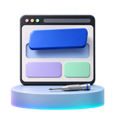
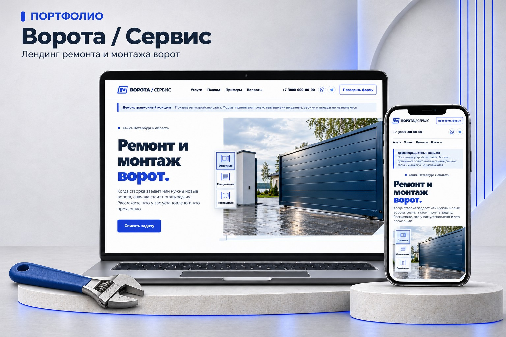

# Решаю задачи бизнеса с помощью сайтов и веб-приложений

## Чем могу помочь

<table role="presentation">
  <tr>
    <td width="92" valign="middle"></td>
    <td valign="middle"><strong>Представить услугу или продукт онлайн</strong> 
      Сделаю сайт, на котором клиент сможет разобраться в предложении, выбрать подходящий вариант и оставить заявку.</td>
  </tr>
  <tr>
    <td valign="middle"></td>
    <td valign="middle"><strong>Рассчитать стоимость по вашим правилам</strong> 
      Сделаю калькулятор, в котором клиент или сотрудник сможет выбрать нужные параметры, сразу увидеть итог и понять, из чего он складывается.</td>
  </tr>
  <tr>
    <td valign="middle"></td>
    <td valign="middle"><strong>Вести учёт и видеть, что меняется</strong> 
      Сделаю трекер, в котором можно фиксировать нужные данные, видеть текущее состояние и смотреть, как оно менялось со временем.</td>
  </tr>
  <tr>
    <td valign="middle"></td>
    <td valign="middle"><strong>Доработать то, чем вы уже пользуетесь</strong> 
      Разберусь в существующем сайте или приложении и добавлю нужную функцию, исправлю неудобный сценарий или обновлю страницу.</td>
  </tr>
</table>

## Примеры решений

<table>
  <tr>
    <td width="168" valign="middle"></td>
    <td valign="middle"><strong>Ворота / Сервис</strong> 
      Посетитель выбирает тип ворот по фото и составляет запрос на ремонт или монтаж. 
      <a href="https://gate-service-demo-mw.pages.dev/">Посмотреть сайт</a></td>
  </tr>
</table>

### Поток

Канбан для небольшой команды. Руководитель назначает задачи, исполнитель меняет статус своих карточек, наблюдатель видит ход работы. [Код и скриншоты на GitHub](https://github.com/michaelluxwork/potok-task-tracker)

- **Tonalitix.** Собирает отзывы о мобильных приложениях, показывает, на что жалуются пользователи, и помогает сравнивать продукты.
- **Moveo.** Предлагает короткие разминки для тех, кто долго сидит за компьютером. Камера помогает отслеживать движения во время упражнения. [Открыть Moveo](https://moveoapp.ru/)
- **Полотно.** Покупатель меняет параметры двери и сразу видит, как меняется стоимость. [Открыть калькулятор](https://michaelluxwork.github.io/calculator-portfolio/doors/)

## Как работаю

Сначала разбираемся, что должно заработать и кто будет этим пользоваться. Затем согласуем объём и смотрим первую версию на вашем сценарии. Перед передачей я проверяю основные действия и готовлю инструкцию по запуску.

## Связаться

Я Михаил Сидаченко, веб-разработчик с опытом больше десяти лет. В студиях создавал и дорабатывал сайты, порталы, CRM и ERP.

Расскажите, как вы решаете задачу сейчас и что хотелось бы упростить. С этого начнём разговор.

[Написать мне в Telegram](https://t.me/michaelluxsd) · [Мой блог](https://t.me/michaelluxsd_work)
